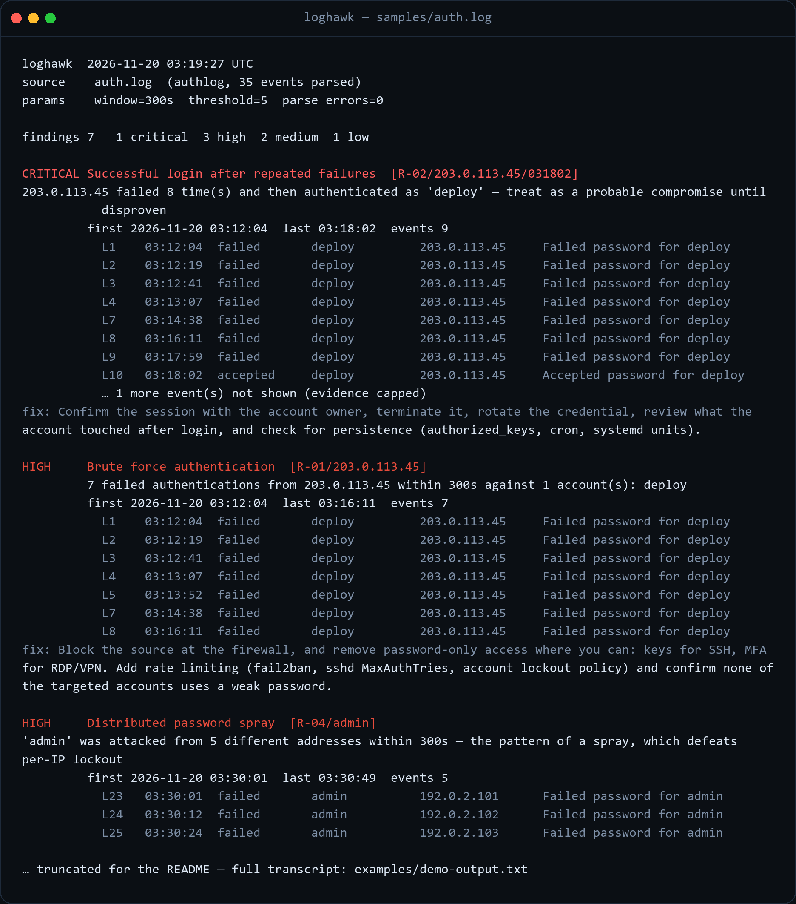
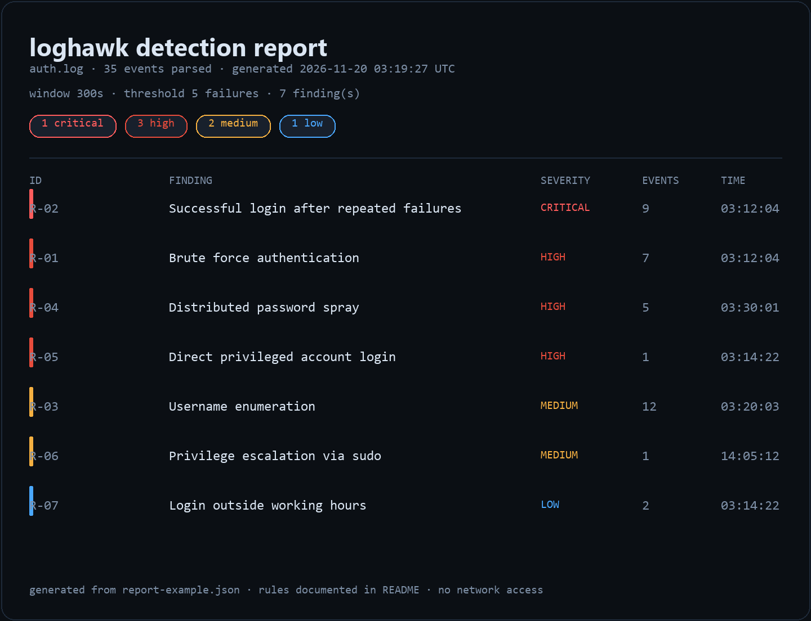
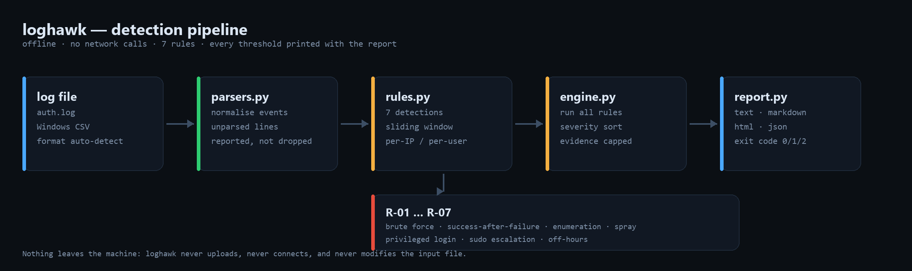

# loghawk

An offline detection engine for authentication logs. Point it at an OpenSSH
`auth.log` or a Windows Security CSV export and it tells you, with line numbers
and a remediation note, where someone was brute forcing, spraying, enumerating
accounts, or logging in at 3 AM from an address that should not know your
hostname exists.

No agents. No SIEM. No network calls. Python standard library only.

```
python -m loghawk samples/auth.log
```



---

## Why this exists

Reading 40,000 lines of `auth.log` with `grep | sort | uniq -c` works until it
does not: you cannot see that the *same* address failed eight times and then
succeeded, because the successful line looks like any other.

`loghawk` exists to answer the questions an analyst actually asks:

- which source addresses failed repeatedly, and did any of them later succeed?
- was one account attacked from many addresses (spray), not one (brute force)?
- did an attacker enumerate usernames before trying passwords?
- what happened after a suspicious login — did the session escalate to root?

Every report prints the thresholds that produced it, so a finding is
reproducible: same file plus same flags equals same output.

## Supported input

| Format | Detection | Notes |
| --- | --- | --- |
| OpenSSH `auth.log` / `/var/log/secure` | syslog line shape | `sshd` and `sudo` lines; year inferred, December → January rollover handled |
| Windows Security CSV export | `EventID` column present | `4624`, `4625`, `4634`, `4647`, `4648`, `4672`; failure reason decoded from `Status` |

Exporting the Windows log:

```powershell
Get-WinEvent -FilterHashtable @{LogName='Security'; Id=4624,4625,4672} |
  Select-Object TimeCreated, Id, MachineName, @{n='TargetUserName';e={$_.Properties[5].Value}},
                @{n='IpAddress';e={$_.Properties[18].Value}}, @{n='LogonType';e={$_.Properties[8].Value}},
                @{n='Status';e={$_.Properties[7].Value}} |
  Export-Csv -NoTypeInformation windows-security.csv
```

Lines that cannot be parsed are counted and listed — a parser gap shows up in
the report instead of silently shrinking the evidence.

## Detection rules

| Rule | Detection | Severity | Default trigger |
| --- | --- | --- | --- |
| R-01 | Brute force authentication | HIGH | 5+ failures from one address within 300s |
| R-02 | Successful login after repeated failures | CRITICAL | 3+ failures in the previous hour, then a success from the same address |
| R-03 | Username enumeration | MEDIUM | 10+ distinct usernames from one address within 300s |
| R-04 | Distributed password spray | HIGH | one account attacked from 5+ addresses within 300s |
| R-05 | Direct privileged account login | HIGH | successful login as `root`/`admin`/`administrator` |
| R-06 | Privilege escalation via sudo | MEDIUM | sudo command opening a shell or touching credentials (`/bin/bash`, `su -`, `passwd`, `/etc/sudoers`, …) |
| R-07 | Login outside working hours | LOW | successful login outside 08:00–18:00 (configurable) |

Rule references point at the corresponding MITRE ATT&CK technique
(T1110.001, T1110.003, T1589.002, T1078, T1548.003), so the report can be
dropped into an existing detection-engineering vocabulary.

Two design choices worth calling out:

- **R-02 looks back further than R-01.** Brute force is measured in a short
  window, but an attacker often waits before using a guessed credential. The
  lookback is a separate parameter (`--lookback`, default 3600s) rather than a
  multiple of the window, so both are explicit.
- **Evidence is capped, never hidden.** When a finding has more events than
  `max_evidence`, the report shows the first and last few *and* prints how many
  were omitted. A silent gap in an evidence list is how reports lose trust.

## Usage

```
loghawk [-h] [--window SECONDS] [--lookback SECONDS] [--threshold N]
        [--enum-users N] [--spray-ips N] [--work-start HOUR] [--work-end HOUR]
        [--year YYYY] [--format {text,md,html,json}] [--out DIR]
        [--no-color] [--quiet] [--version] logfile
```

| Flag | Default | What it does |
| --- | --- | --- |
| `--window` | 300 | sliding window, in seconds, for R-01/R-03/R-04 |
| `--lookback` | 3600 | how far back R-02 looks for failures before a success |
| `--threshold` | 5 | failures per window to raise brute force |
| `--enum-users` | 10 | distinct usernames per window for enumeration |
| `--spray-ips` | 5 | distinct source addresses per account for spray |
| `--work-start` / `--work-end` | 8 / 18 | working hours for R-07, 24h clock |
| `--year` | current | year assumed for syslog lines (they carry none) |
| `--format` | text | `text`, `md`, `html`, `json` |
| `--out DIR` | – | also write `report.md`, `report.html`, `report.json` |
| `--quiet` | off | files only, no stdout — for cron |

`logfile` may be `-` to read stdin, so it composes with `ssh`:

```bash
ssh web01 'cat /var/log/auth.log' | python -m loghawk - --format json
```

### Examples

Tighten the thresholds for a noisy shared host:

```bash
python -m loghawk /var/log/auth.log --threshold 3 --window 120
```

Full report set for a client deliverable:

```bash
python -m loghawk samples/auth.log --out reports --quiet
```

Feed a dashboard:

```bash
python -m loghawk samples/auth.log --format json | jq '.summary.by_severity'
```

## Sample output

Real run over the committed sample, captured in
[`examples/demo-output.txt`](examples/demo-output.txt):

```
loghawk  2026-11-20 03:19:27 UTC
source    auth.log  (authlog, 35 events parsed)
params    window=300s  threshold=5  parse errors=0

findings 7   1 critical  3 high  2 medium  1 low

CRITICAL Successful login after repeated failures  [R-02/203.0.113.45/031802]
         203.0.113.45 failed 8 time(s) and then authenticated as 'deploy' — treat as a probable compromise until disproven
         first 2026-11-20 03:12:04  last 03:18:02  events 9
           L1    03:12:04  failed       deploy         203.0.113.45     Failed password for deploy
           …
         fix: Confirm the session with the account owner, terminate it, rotate the credential, …
```

The same run as a summary card, rendered straight from
[`examples/report-example.json`](examples/report-example.json):



Full examples are committed as
[`.md`](examples/report-example.md), [`.html`](examples/report-example.html) and
[`.json`](examples/report-example.json); a Windows run is in
[`examples/windows-demo-output.txt`](examples/windows-demo-output.txt).

## Architecture



| Module | Responsibility |
| --- | --- |
| `loghawk/parsers.py` | syslog and Windows CSV parsing, format auto-detection, unparsed-line reporting |
| `loghawk/models.py` | `Event`, `Finding`, `Report`; the JSON contract |
| `loghawk/rules.py` | the seven detections, each a pure function of `(events, config)` |
| `loghawk/engine.py` | runs every rule, sorts by severity, reports coverage |
| `loghawk/report.py` | console, Markdown, JSON and self-contained HTML |
| `loghawk/cli.py` | arguments, orchestration, exit codes |
| `tools/` | README image generators, driven by the JSON report |

Rules are pure functions on purpose: they can be tested without a log file, and
adding a rule means adding one function to `ALL_RULES` — no engine changes.

## Sample data

`samples/auth.log` and `samples/windows-security.csv` are **synthetic**, written
by [`samples/generate_samples.py`](samples/generate_samples.py) to exercise every
rule. They are not captures, and every address is from an RFC 5737 documentation
range (`192.0.2.0/24`, `198.51.100.0/24`, `203.0.113.0/24`).

```bash
python samples/generate_samples.py   # regenerates both files deterministically
```

## Tests

```bash
python -m unittest discover -s tests -v
```

23 tests, all offline: parser shapes, year rollover, Windows event mapping,
each rule's trigger and its negative case, window boundaries, and the four
renderers.

```
Ran 23 tests in 0.007s

OK
```

## Limitations

- **One file per run.** Log rotation means several files; concatenate them
  first (`cat auth.log auth.log.1 | python -m loghawk -`).
- **No cross-host correlation.** Events are analysed per file; a spray spread
  across ten servers shows up as ten smaller incidents.
- **Syslog has no year.** It is inferred from `--year` and month rollover, so a
  log spanning more than one year boundary needs one run per file.
- **Thresholds are opinions.** Five failures in five minutes is loud on a small
  host and normal on an internet-facing jump box. They are flags, not truth.
- **No baseline or anomaly scoring.** Every detection is a fixed rule; nothing
  learns what normal looks like.
- **Not a SIEM.** No ingestion, retention, dashboards, or alerting — it reads a
  file and writes a report.

## Handling real logs

Authentication logs contain usernames, source addresses and hostnames, which in
many jurisdictions is personal data. `loghawk` never sends anything off the
machine, but the reports it produces still need the same care as the log itself:
redact before sharing outside the engagement, and keep the JSON with the same
access controls as the evidence it came from.

## Roadmap

- [ ] `--baseline baseline.json` to flag only new actors per rule
- [ ] multi-file mode with a per-host summary
- [ ] journald JSON export parser
- [ ] optional Sigma rule export for the detections that map 1:1

## License

MIT — see [LICENSE](LICENSE).

---

Built by Fernando Iskandar. Rule shapes follow common SOC detection patterns;
the thresholds and the lookback split are my own and documented above so they
can be argued with.
